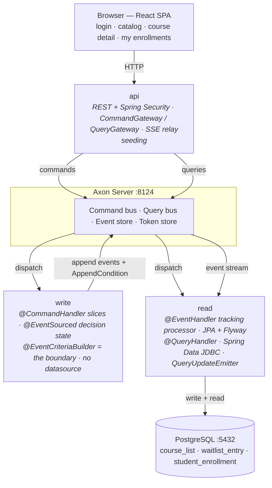
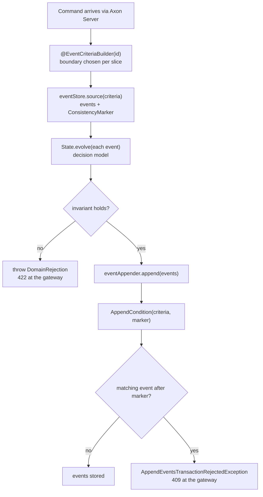

# Architecture Research

**Domain:** Axon Framework 5 Dynamic Consistency Boundary (DCB) demo — course enrollment with seat capacity, FIFO waitlist, React SPA
**Researched:** 2026-11-10
**Confidence:** MEDIUM (DCB mechanics read from official AxonIQ docs + the `AxonIQ/university-demo` source; the distributed topology uses commercial Axoniq modules and is flagged for verification across Phases 1, 3 and 4)

> **Architecture pivot (2026-11-10):** single process with an embedded store was replaced by three services behind Axon Server with a PostgreSQL read model. Sections below reflect the pivot.

## Standard Architecture

Axon 5's opinionated answer is vertical slices: `events`, `courses-write`, `courses-read`, `automation`, where "each slice can have its own entities based on the same events, and thus be totally independent." This project keeps that shape but distributes it: the slices live in different services, and the event store is Axon Server.

### System Overview



### Module responsibilities

| Module | Owns | Must NOT |
|---|---|---|
| `courses-platform` | Re-exports the Boot and Axoniq BOMs (Boot manages Jackson) via `api(platform(...))` with `allowDependencies()` | Contain code |
| `courses-domain` | Events, commands, queries, ids, tag keys, `DomainRejection` | Depend on Spring, JPA, or any service module |
| `courses-write` | Command handlers, per-slice decision state, `@EventCriteriaBuilder`, the only `EventAppender` calls | Have a datasource, JPA, or read models |
| `courses-read` | `@EventHandler` projections writing PostgreSQL (JPA + Flyway), `@QueryHandler`s reading through Spring Data JDBC, and the subscription-query emitter | Append events or answer commands |
| `courses-api` | REST, security, gateways, SSE stream returned as `Flux`, seeding | Touch SQL, append events, subscribe to the event stream, or depend on `courses-write`/`courses-read` implementations |
| `courses-frontend` | React/Vite build | Contain domain logic |

### The DCB decision pipeline (the one diagram the README should reuse)



The key property to teach: **the same `EventCriteria` is both the read filter and the write-conflict definition.** Axon Server enforces it across processes; the gateway only translates the failure.

### Suggested boundaries, per command (the core design artifact)

All commands are in one bounded context, `courses`. Tags: `courseId`, `studentId`. Identifiers are UUIDv7 wrapped in `@JvmInline value class`es; the canonical UUID string is the tag value. `CreateCourse` takes a client-supplied `courseId` so a retried create is decided against existing events instead of producing a duplicate.

| Command | Sourced by | Event types the decision may see | Invariant it proves |
|---|---|---|---|
| `CreateCourse` | `courseId` | `CourseCreated` | no duplicate course |
| `EnrollStudent` | `courseId` | `CourseCreated`, `StudentEnrolled`, `StudentDropped`, `WaitlistJoined`, `WaitlistPromoted` | `seatsTaken < capacity`; not already enrolled; not already waitlisted |
| `JoinCourseWaitlist` | `courseId` | `CourseCreated`, `StudentEnrolled`, `StudentDropped`, `WaitlistJoined`, `WaitlistPromoted` | only waitlist when full; not already enrolled or waitlisted |
| `DropEnrollment` | `courseId` | `CourseCreated`, `StudentEnrolled`, `StudentDropped`, `WaitlistJoined`, `WaitlistPromoted` | dropper owns the enrollment; exactly one FIFO promotion |

Three teaching points belong in the design note:

1. **Same tag, different type set.** Every slice filters on `courseId` alone, yet each includes a different subset of event types. The boundary is dynamic because the *criteria* is per-decision, not because the tag changes.
2. **Tags select; payloads decide.** `StudentEnrolled` carries both `courseId` and `studentId`, but `EnrollStudent` asks only for `courseId`. The "already enrolled?" check still works from the payload.
3. **Widening later costs nothing.** A "max N seats per student" rule adds one `EventCriteria.havingTags(Tag.of("studentId", …))` to the `either(...)` union in one method.

## Recommended Project Structure

```text
axon5-courses/
├── settings.gradle.kts                  # include platform, domain, write, read, api, frontend
├── build.gradle.kts                     # root: catalog wiring only
├── compose.yaml                         # axonserver + postgres
├── gradle/libs.versions.toml
├── docs/
│   ├── design-note.md
│   └── event-tag-table.md
├── courses-platform/build.gradle.kts            # java-platform: re-exports Boot + Axoniq BOMs
├── courses-domain/
│   └── src/main/kotlin/io/github/aanbrn/courses/
│       ├── events/                      # THE CONTRACT — every service compiles against this
│       ├── commands/
│       ├── queries/
│       ├── ids/
│       └── errors/DomainRejection.kt
├── courses-write/
│   └── src/main/kotlin/io/github/aanbrn/courses/
│       ├── WriteApplication.kt
│       ├── config/AxonConfig.kt         # connector only; no datasource
│       ├── courses-write/
│       │   ├── createcourse/
│       │   ├── enrollstudent/           # EnrollStudentHandler + EnrollmentDecision ◄ ANNOTATE ME
│       │   ├── joincoursewaitlist/
│       │   └── dropenrollment/          # DropEnrollmentHandler + CourseSeatingState
│       └── (no read models, no JPA)
├── courses-read/
│   └── src/main/kotlin/io/github/aanbrn/courses/
│       ├── ReadApplication.kt
│       ├── projection/courselist/…      # @EventHandler → JPA entity → emit after commit
│       ├── projection/waitlist/…
│       ├── projection/mystudentseats/…
│       ├── query/…                      # @QueryHandler → Spring Data JDBC, immutable rows
│       └── live/WatchCourseViewHandler.kt  # QueryUpdateEmitter
│   └── src/main/resources/db/migration/ # Flyway — the read service owns the schema
├── courses-api/
│   └── src/main/kotlin/io/github/aanbrn/courses/
│       ├── ApiApplication.kt
│       ├── web/                         # CourseController · EnrollmentController
│       ├── security/SecurityConfig.kt
│       ├── seed/DataSeeder.kt           # ApplicationRunner → CommandGateway
│       └── errors/ApiExceptionHandler.kt
└── courses-frontend/
    ├── build.gradle.kts                 # npm via Exec: npm ci → vite build → dist/ · lint:fsd
    ├── package.json · vite.config.ts    # '@/' alias → src
    ├── steiger.config.js                # FSD layer and public-API rules
    └── src/
        ├── app/                         # providers, router, styles
        ├── pages/                       # login · courses · course-detail · my-enrollments
        ├── widgets/                     # course-table · waitlist-panel · connection-status
        ├── features/                    # session/login · course/create · enrollment/{enroll,drop} · waitlist/join
        ├── entities/                    # course · enrollment · waitlist · student
        └── shared/                      # api (fetch, sse) · ui · lib · config
```

### Structure Rationale

- **`courses-domain` first.** Every service compiles against one contract; if commands lived in `courses-write`, the gateway would depend on the write implementation and the split would be cosmetic.
- **One state class per slice, never shared.** Two slices reading the same events may hold different fields. Sharing an entity re-couples slices and silently widens boundaries.
- **`courses-write` has no datasource.** This is the structural guarantee that JPA's event-store auto-config cannot hijack the DCB store; it also makes "the write side never reads a read model" impossible to violate accidentally.
- **One `courses-read` service owns the schema end to end.** The projection path uses JPA (mutable entities, transactions, Flyway); the query path uses Spring Data JDBC into immutable row types. A startup smoke check runs every read query with `LIMIT 0` and fails fast on drift. Splitting these into two services was tried and reverted: live updates would have needed a cross-service notification, and a command cannot honestly carry a fact.
- **`courses-api` is disposable.** Controllers only translate HTTP ↔ messages. If the REST shape changes, no domain code moves.
- **Seeding uses commands, not `EventAppender`.** Startup data must exercise the same handlers a user would; direct appends would bypass invariants.

## Data Flow

### Flow 1 — Enroll (happy path, and the invariant)

```text
click "Enroll"
  → POST /courses/{courseId}/enrollments (session cookie)
  → api: CommandGateway.send(EnrollStudent)   → Axon Server
  → write service: EnrollStudentHandler
      → @EventCriteriaBuilder(courseId)
      → source(criteria) → events + ConsistencyMarker
      → decide(): seatsTaken(9) < capacity(10) ✓, not enrolled ✓ → [StudentEnrolled]
      → append with AppendCondition(criteria, marker)
  → Axon Server stores the event
  → api returns 201
  → read consumes StudentEnrolled → PostgreSQL row updated → emits the new view
  → SSE push from the gateway → the catalog re-renders the new seat count
```

### Flow 2 — Drop + FIFO promotion

```text
click "Drop"
  → DropEnrollmentHandler
      → boundary: courseId, types {CourseCreated, StudentEnrolled, StudentDropped,
                                   WaitlistJoined, WaitlistPromoted}
      → CourseSeatingState: enrolled(Dave), waitlist=[Erin, Frank]
      → decide(): Dave enrolled ✓; head = Erin
      → append [StudentDropped(Dave), WaitlistPromoted(Erin)]   ← one append, one condition
  → read receives both events; the read model never shows "seat free, nobody promoted"
```

### Flow 3 — Read path

```text
GET /courses
  → api: QueryGateway.query(FindCourses) → Axon Server
  → read: @QueryHandler → SELECT from PostgreSQL
  → JSON response
```

## Distributed Concerns

| Concern | Decision | Why |
|---|---|---|
| Eventual consistency | Read-model changes are pushed over SSE; the lag is visible, not hidden. `courses-read` writes and emits from one process | The emitter is local to the node advertising the query; owning both in one service removes the question |
| Token store | Axon Server default | No extra table, survives restarts, one fewer moving part |
| Schema ownership | Flyway in `courses-read` only; the query path has no DDL tooling and fails fast via a startup smoke check | One writer, fail-fast reader |
| Command sequencing | No routing key on `EnrollStudent` | A shared routing key serializes the race away |
| Seeding | Gateway dispatches commands | Same path as a user |
| Errors | 409 append conflict vs 422 business rejection | The gateway must not collapse them |
| License | Commercial Axoniq starter + connector; local evaluation only | Production use is out of scope |

## Anti-Patterns

- **`spring-boot-starter-data-jpa` in `courses-write`** — installs an aggregate-based event store and voids DCB.
- **JPA in the query path** — brings dirty checking, callbacks and entity lifecycle into a read that should be immutable.
- **Shared JPA entity classes across services** — couples two persistence models; each service maps the schema itself.
- **Read models consulted inside a command handler** — the decision must source events.
- **Gateway doing SQL or event-store access** — it becomes a second write path and the boundary story dies.
- **Forwarding domain events to the browser** — couples the UI to the event schema and turns the read model into a second-class citizen; stream whole read-model snapshots instead.
- **A routing key on `EnrollStudent`** — serializes the race and makes the test green for the wrong reason.
- **AF4 aggregate APIs** (`@Aggregate`, `@TargetAggregateIdentifier`) — removed or renamed in AF5.
- **Kafka/JGroups extensions** — AF4-era (latest 4.12.1), not available for AF5.

## Verification Items

- **Phase 1:** the commercial starter boots on Boot 4.1.2 and Axon Server stays up through the license window.
- **Phase 3:** `@EventSourced` on a nested Kotlin state class with `idType`; `@EventTag` and `@JvmStatic` criteria builders; stored tags actually persisted.
- **Phase 4:** append conditions enforced by Axon Server across two processes, with `maxInFlight > 1` proving the race is not serialized by command sequencing.
- **Phase 5:** `courses-read` starts its tracking processor from the stream head and resumes after restart (Axon Server token store).
